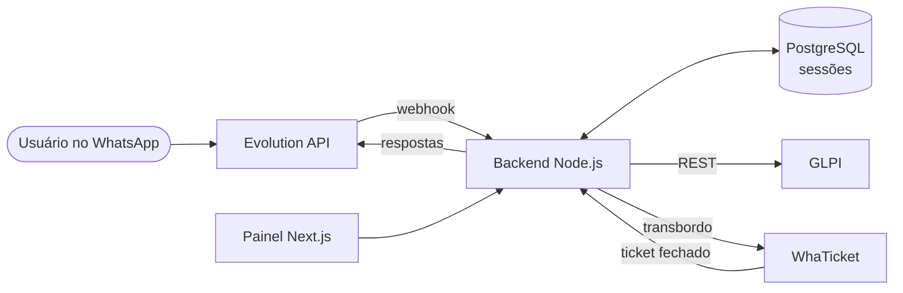
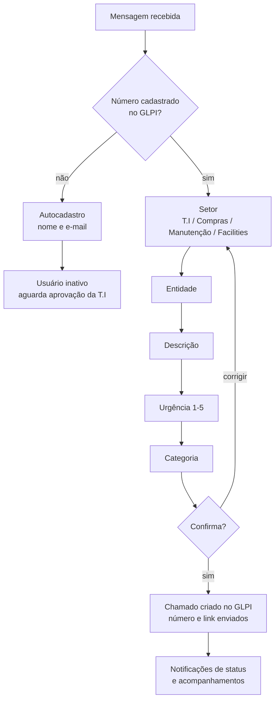

# Chamados GLPI pelo WhatsApp

Bot de autoatendimento que abre chamados no **GLPI** direto pelo **WhatsApp**, com triagem no padrão **ITIL**, notificação de andamento ao usuário e transbordo para atendimento humano.

> Projeto de laboratório. Nenhum dado real de empresa, usuário ou credencial está neste repositório.


## Por que existe

Em muitas empresas o usuário não abre chamado pelo portal: ele manda mensagem no WhatsApp de alguém da T.I. O pedido se perde, não tem SLA e não entra na fila. Este bot leva o atendimento para onde o usuário já está e garante que **todo pedido vira um chamado no GLPI**, com tipo, urgência e categoria corretos.

## Funcionalidades

- **Identificação pelo número do WhatsApp:** o usuário é localizado no GLPI pelo telefone cadastrado.
- **Autocadastro:** número desconhecido pode se cadastrar pelo próprio WhatsApp. O usuário é criado **inativo** no GLPI e só recebe o acesso depois que a T.I aprova.
- **Vários setores:** T.I, Compras, Manutenção Predial e Facilities, cada um com perguntas próprias e categorias do GLPI.
- **Triagem ITIL:** entidade, descrição, urgência (1 a 5) e categoria, com resumo e confirmação antes de criar o chamado.
- **Notificações:** o usuário recebe no WhatsApp as mudanças de status e os acompanhamentos do chamado, em horário comercial.
- **Transbordo humano:** "humano", "atendente" ou "ajuda", ou 3 respostas inválidas seguidas, transferem para o WhaTicket. Quando o atendente fecha o ticket, o chamado é solucionado no GLPI.
- **Painel administrativo (AdminJS)** para ver e encerrar sessões, e **painel web (Next.js)** para acompanhar os chamados.

## Como funciona



### Fluxo da conversa



A qualquer momento, "humano", "atendente" ou "ajuda" transferem para o atendimento humano. Uma sessão parada por 30 minutos recomeça na próxima mensagem.

## Stack

| Camada | Tecnologia |
| --- | --- |
| Backend | Node.js 20, Express, TypeScript |
| Banco | PostgreSQL 16 com Sequelize |
| WhatsApp | Evolution API v2 (Docker) |
| ITSM | GLPI (REST API) |
| Transbordo | WhaTicket Community |
| Painéis | AdminJS e Next.js 14 com Bootstrap |
| Infraestrutura | Docker Compose |

## Como rodar

**Pré-requisitos:** Docker e Docker Compose, Node.js 20+, uma instância GLPI com a REST API habilitada e um número de WhatsApp dedicado.

```bash
git clone https://github.com/fbvenceslau/glpi-whatsapp-chamados.git
cd glpi-whatsapp-chamados

# 1. Variáveis de ambiente (o .env fica na raiz do projeto)
cp backend-main/.env.example .env
# edite o .env com os dados do seu GLPI e da Evolution API

# 2. Lockfile do backend (necessário para o build Docker)
cd backend-main && npm install && cd ..

# 3. Sobe PostgreSQL, backend e Evolution API
docker compose up -d
```

4. Abra o painel da Evolution API em `http://localhost:8080` e leia o QR Code com o WhatsApp do suporte.
5. Painel administrativo: `http://localhost:3001/admin`.
6. Painel web (opcional): `cd frontend-main && npm install && npm run dev`, depois abra `http://localhost:3000`.

### Preparação no GLPI

1. **Configurar > Geral > API:** habilite a REST API e crie um *Application Token*.
2. Crie um usuário técnico só para a integração e gere o *User Token* dele em **Preferências > Chaves de acesso remoto**.
3. Opcional: em **Configurar > Listas suspensas > Origens das requisições**, crie "WhatsApp" e informe o ID em `GLPI_REQUEST_TYPE_ID`.

## Variáveis de ambiente

O modelo completo está em [`backend-main/.env.example`](backend-main/.env.example). As principais:

| Variável | Para que serve |
| --- | --- |
| `GLPI_BASE_URL` | Endereço da API, ex.: `http://glpi.local/apirest.php` |
| `GLPI_APP_TOKEN` / `GLPI_USER_TOKEN` | Autenticação na API do GLPI |
| `GLPI_PORTAL_URL` | Link do portal enviado ao usuário |
| `EVOLUTION_API_KEY` / `EVOLUTION_INSTANCE` | Acesso à instância do WhatsApp |
| `DB_*` | Conexão com o PostgreSQL |
| `WEBHOOK_SECRET` | Protege o webhook da Evolution |
| `WHATICKET_WEBHOOK_SECRET` | Protege o webhook do WhaTicket |
| `ADMIN_EMAIL` / `ADMIN_PASSWORD` | Login do painel `/admin` |
| `SESSION_TIMEOUT_MINUTES` | Tempo para reiniciar a conversa (padrão 30) |

> Nunca envie o `.env` para o Git. Ele já está no `.gitignore`.

## Endpoints

| Método | Rota | Proteção | Função |
| --- | --- | --- | --- |
| `POST` | `/webhook/evolution` | `x-webhook-secret` | Mensagens recebidas do WhatsApp |
| `POST` | `/webhook/whaticket` | `x-whaticket-secret` | Ticket fechado no WhaTicket |
| `GET` | `/webhook/health` | nenhuma | Health check |
| `GET` | `/api/glpi/categories?type=1\|2` | `x-api-key` | Categorias do GLPI |
| `GET` | `/api/glpi/users?email=` | `x-api-key` | Busca de usuário no GLPI |

## Integração com o WhaTicket

Para o fechamento no WhaTicket solucionar o chamado no GLPI, envie este evento quando um ticket for fechado:

```typescript
await axios.post(`${process.env.CHAMADOS_BACKEND_URL}/webhook/whaticket`, {
  event: 'ticket.closed',
  ticket: { id: ticket.id, status: 'closed', contact: { number: ticket.contact.number } },
}, { headers: { 'x-whaticket-secret': process.env.WHATICKET_WEBHOOK_SECRET } });
```

## Estrutura

```
├── docker-compose.yml
├── backend-main/
│   └── src/
│       ├── app.ts                    # Express, rotinas agendadas e AdminJS
│       ├── controllers/              # webhooks e consultas ao GLPI
│       ├── services/
│       │   ├── triagem.service.ts    # máquina de estados da conversa (ITIL)
│       │   ├── conversation.service.ts
│       │   ├── glpi.service.ts       # cliente da REST API do GLPI
│       │   ├── evolution.service.ts  # envio de mensagens
│       │   ├── registration.service.ts       # autocadastro
│       │   └── ticket-notification.service.ts # avisos de andamento
│       ├── models/                   # sessões, cadastros pendentes, notificações
│       └── middlewares/              # autenticação dos webhooks e da API
└── frontend-main/                    # painel Next.js
```

## Autor

**Fábio Venceslau** · Analista de Redes NOC/SOC
[Portfólio](https://fbvenceslau.github.io) · [LinkedIn](https://www.linkedin.com/in/fabio-venceslau/)
